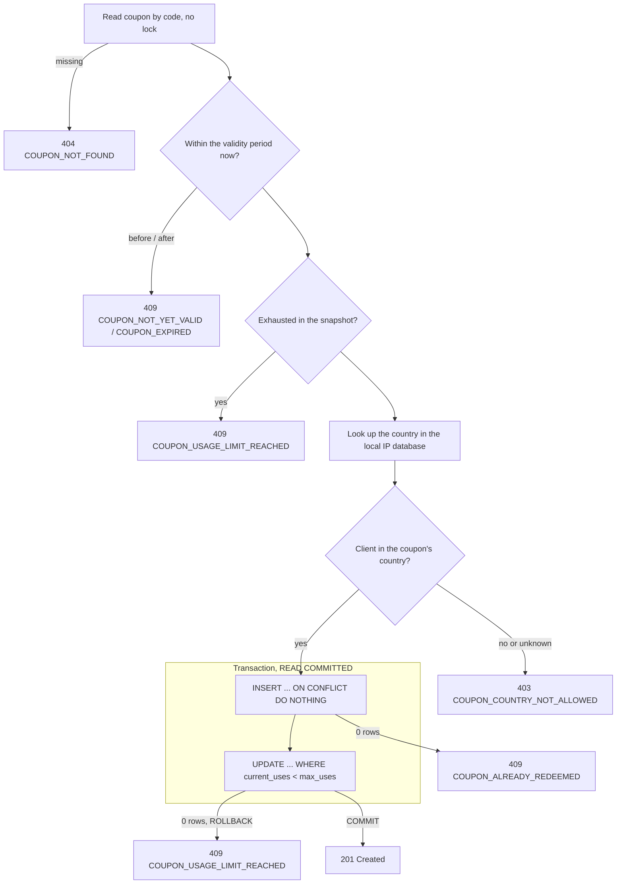

# Coupon Service

REST service for creating discount coupons and redeeming them. A coupon has a case-insensitive
unique code, a usage limit and a country; it can be redeemed only from that country (by client IP),
first come first served, and at most once per user.

**Stack:** Java 25 (LTS), Spring Boot 4.2, PostgreSQL 19, Hibernate 7, Flyway, Gradle 9,
DB-IP IP-to-country database read with MaxMind's reader, JUnit 6, Testcontainers 2, ArchUnit.

## Quick start

```bash
# Everything in containers (PostgreSQL 19 + the service on :8080)
docker compose --profile app up --build

# Or run the service locally; spring-boot-docker-compose starts PostgreSQL from compose.yaml.
# The first run downloads the IP-to-country database (8 MB) into build/geo.
./gradlew bootRun
```

```bash
# Create a coupon (codes are case-insensitive and stored upper case)
curl -i -X POST localhost:8080/api/v1/coupons -H 'Content-Type: application/json' \
     -d '{"code": "wiosna", "maxUses": 2, "country": "PL"}'

# Redeem it as a client from Poland. The service trusts X-Forwarded-For only from trusted
# proxies; localhost and private networks are trusted by default, so locally it stands in
# for the client IP. 212.77.98.9 is in Poland, 46.4.0.1 in Germany.
curl -i -X POST localhost:8080/api/v1/coupons/WIOSNA/redemptions -H 'Content-Type: application/json' \
     -H 'X-Forwarded-For: 212.77.98.9' -d '{"userId": "user-1"}'
```

More ready-made calls are in [`requests.http`](requests.http). Swagger UI: <http://localhost:8080/swagger-ui.html>.
Metrics: `/actuator/prometheus`, health probes: `/actuator/health/{liveness,readiness}`.

Tests need Docker (Testcontainers): `./gradlew build` runs unit, web, integration, end-to-end and
architecture tests plus the coverage gate.

## API

| Method and path | Body | Success |
| --- | --- | --- |
| `POST /api/v1/coupons` | `{"code", "maxUses", "country", "validFrom"?, "validUntil"?}` | `201` with `Location` and the coupon |
| `GET /api/v1/coupons/{code}` | | `200` with the coupon |
| `POST /api/v1/coupons/{code}/redemptions` | `{"userId"}` | `201` with `Location`, `couponCode`, `userId`, `redeemedAt` |
| `GET /api/v1/coupons/{code}/redemptions/{userId}` | | `200` with the redemption |

`validFrom` and `validUntil` are optional ISO 8601 instants. The period is half-open: a coupon
can be redeemed from `validFrom` (inclusive) until `validUntil` (exclusive), so
`"validUntil": "2026-12-01T00:00:00Z"` means "through the whole of November". A missing side is open.

The `GET` on a redemption is there for a client that lost the answer to its `POST` (timeout,
dropped connection): it checks whether the redemption went through instead of retrying blindly.

Errors are [RFC 9457](https://www.rfc-editor.org/rfc/rfc9457) problem details with an `errorCode`
member. Clients should branch on `errorCode`, since two problems can share a status.

| Situation | Status | `errorCode` |
| --- | --- | --- |
| Missing field, bad code or country format, `maxUses` < 1, `validUntil` not after `validFrom` or not in the future | 400 | `VALIDATION_FAILED` |
| Body is not valid JSON | 400 | `MALFORMED_REQUEST` |
| Code already exists, in any letter case | 409 | `COUPON_CODE_ALREADY_EXISTS` |
| Coupon does not exist | 404 | `COUPON_NOT_FOUND` |
| Coupon exists, but this user has not redeemed it (`GET` on a redemption) | 404 | `REDEMPTION_NOT_FOUND` |
| Client country differs from the coupon's, or cannot be determined | 403 | `COUPON_COUNTRY_NOT_ALLOWED` |
| Before `validFrom` | 409 | `COUPON_NOT_YET_VALID` |
| At or after `validUntil` | 409 | `COUPON_EXPIRED` |
| Usage limit reached | 409 | `COUPON_USAGE_LIMIT_REACHED` |
| This user already redeemed this coupon | 409 | `COUPON_ALREADY_REDEEMED` |
| Database down, or every pooled connection busy for 2 s (overload) | 503 + `Retry-After` | `SERVICE_UNAVAILABLE` |
| Unknown path, wrong method or media type | 404, 405, 415... | `UNSUPPORTED_REQUEST` |
| Anything unforeseen (logged with its stack trace, never returned) | 500 | `INTERNAL_ERROR` |

## Architecture

Hexagonal, in one module. The domain and the use cases have no framework dependencies;
Spring, Hibernate and HTTP live in adapters behind ports. ArchUnit enforces it.


```
pl.hadacz.coupons
├── coupon
│   ├── domain           value objects, Coupon, RedemptionResult (sealed)
│   ├── application      use cases; port/ holds CouponRepository and CountryResolver
│   └── adapter
│       ├── web          controllers, request/response records, problem details, metrics
│       ├── persistence  JPA entity, Spring Data repository, port implementation
│       └── geolocation  CountryResolver over the local IP database
└── config               wiring of the framework-free use cases, OpenAPI
```

Commands (create, redeem) go through the domain and a transaction; the query side
(`CouponQueries`) returns a view and could read from a replica. That is all the CQRS this
service needs: with two tables a separate read model would be overhead.

## The core: concurrent redemption

The usage limit and "one use per user" are enforced by PostgreSQL, not by the JVM. Two
statements run in one short `READ COMMITTED` transaction:

```sql
-- 1. Record the redemption; 0 rows means this user already redeemed the coupon.
INSERT INTO coupon_redemptions (coupon_id, user_id, redeemed_at)
SELECT c.id, :userId, :redeemedAt FROM coupons c WHERE c.code = :code
ON CONFLICT (coupon_id, user_id) DO NOTHING;

-- 2. Consume one use only if one is left; 0 rows means the limit is reached -> ROLLBACK.
UPDATE coupons SET current_uses = current_uses + 1
WHERE code = :code AND current_uses < max_uses;
```



Every refusal before the transaction (dates, exhausted, country) first checks
whether this user already redeemed the coupon, and if so answers `COUPON_ALREADY_REDEEMED`
instead: a user who took the last use and retries is told that, not that the coupon ran out.
The lookup is one indexed query on the refusal path only; a successful redemption does not pay for it.

Why this is correct:

- **No over-redemption.** A second `UPDATE` of the same row waits for the row lock; after the
  first transaction commits, PostgreSQL re-evaluates `current_uses < max_uses` against the newest
  row version. The counter cannot pass the limit and no increment is lost.
- **One use per user.** A concurrent `INSERT` of the same (coupon, user) pair waits for the other
  transaction: after its commit it conflicts (0 rows), after its rollback it proceeds.
- **All or nothing.** If the `UPDATE` finds no use left, the transaction rolls back and the
  redemption row disappears with it.
- **Short locks, no deadlocks.** The `INSERT` goes first, so the hot coupon row is locked only from
  the `UPDATE` to `COMMIT`. The foreign key check takes `FOR KEY SHARE` on the coupon row and the
  counter update takes `FOR NO KEY UPDATE`; those modes do not conflict, and every transaction
  locks in the same order.
- **Nothing slow inside the transaction.** Every check runs before it, so locks are held only for
  the two statements.
- **Any number of instances.** The database is the only shared state.
- **Safe fast path.** The exhausted check reads without locks. The counter only grows, so a snapshot
  that says "exhausted" is never wrong.
- **One clock reading.** The instant checked against the validity period is the one stored as
  `redeemed_at`, so a recorded redemption never falls outside the coupon's period, even when the
  request straddles `validUntil`.

`CouponRedemptionConcurrencyTest` races 500 virtual threads for 50 uses (exactly 50 win) and one
user against itself (exactly one wins) on a real PostgreSQL. Tests raise confidence; the guarantee
comes from the SQL above.

## Geolocation and the client IP

- **Client IP.** `server.forward-headers-strategy=native` enables Tomcat's `RemoteIpValve`:
  `X-Forwarded-For` is used only when the request comes from a trusted proxy
  (`server.tomcat.remoteip.internal-proxies`). In production that must be the load balancer's
  addresses. Reading the header directly would let any client claim a Polish IP.
- **Local database.** Countries come from [DB-IP's free IP to Country Lite](https://db-ip.com/db/download/ip-to-country-lite)
  database (CC BY 4.0, no API key, updated monthly) in the standard MaxMind DB format, read into
  memory at startup with MaxMind's own reader (8 MB). A lookup needs no network call, so there is
  no rate limit, no latency and no provider outage: geolocation scales with the service.
  `bootRun` and the image build download the file; tests use MaxMind's small test database.
- **Never guessed.** Private, loopback and similar addresses have no country, whatever the
  database says.
- **Fail closed.** If the country cannot be determined, the coupon is not redeemed (403). A
  country-restricted coupon is a business rule; whether to fail open instead is a business
  decision, not a technical default.
- **GDPR.** An IP address is personal data. The service does not store it, log it or send it
  anywhere.

## Testing

| Level | Tools | What it checks |
| --- | --- | --- |
| Domain | JUnit 6, AssertJ | Code normalization (also under a Turkish default locale), ISO countries, IP classification, coupon invariants, validity period bounds |
| Use cases | In-memory fakes, fixed `Clock` | Every `RedemptionResult`, order of checks, no country lookup for missing, expired or exhausted coupons |
| Web | `@WebMvcTest`, `MockMvcTester` | Status codes, `Location`, problem details, validation |
| Persistence | Testcontainers PostgreSQL 19 | Schema constraints, duplicate codes, the atomic redemption |
| Concurrency | Virtual threads, start gate | Limit never exceeded, one use per user, racing creations of `WIOSNA`/`wiosna` |
| Geolocation | MaxMind's test database | IPv4 and IPv6 lookups, addresses without data, private addresses, a missing file |
| End to end | `RestTestClient` on a random port | Full flow through Tomcat, including `X-Forwarded-For` with IPv4 and IPv6 clients |
| Architecture | ArchUnit | Core free of frameworks, adapters independent |

The build fails below 90% line coverage of the domain and application packages.
`scripts/RedeemStorm.java` (run with `java scripts/RedeemStorm.java WIOSNA 1000`) checks the same
guarantee against a running service over HTTP.

## Decisions

**ADR 1: Enforce the limit atomically in PostgreSQL.** A conditional `UPDATE` plus
`INSERT ... ON CONFLICT` in one transaction. Rejected: JVM locks (work within one instance only);
load-modify-save with JPA (classic lost update); optimistic locking with `@Version` (a popular coupon
turns into a storm of conflicts and retries); `SELECT ... FOR UPDATE` (holds the lock through the
read, the Java logic and the write); `SERIALIZABLE` (needs retry handling for no benefit, since one
statement is already atomic); a Redis counter (a second source of truth and more infrastructure).

**ADR 2: Normalize codes in the domain, enforce uniqueness in the database.** `CouponCode` upper-cases
with `Locale.ROOT` and the column has a plain `UNIQUE` constraint, so a race between `WIOSNA` and
`wiosna` has exactly one winner. Rejected: `citext` or a unique index on `lower(code)`; they work
but hide the business rule in the database.

**ADR 3: Hibernate for CRUD, explicit SQL for the redemption.** The team's stack is Hibernate, and it
keeps the create/read code short. The redemption needs exact SQL semantics, so it is a JPQL bulk
update and a native insert, both `Propagation.MANDATORY` so they cannot run outside the redemption
transaction. The bulk update bypasses the persistence context, which is safe because that transaction
never loads the entity. Also deliberate: `open-in-view=false`, `ddl-auto=validate` against Flyway,
UUIDv7 ids generated by Hibernate (so `save` is a persist, not a merge), and `saveAndFlush` on create
so a duplicate code surfaces inside the adapter.

**ADR 4: Business outcomes as values.** `RedemptionResult` is a sealed interface of records and the
controller maps it with an exhaustive `switch`: a new outcome does not compile until it has an HTTP
mapping. Exceptions are reserved for invalid input and technical failures.

**ADR 5: A local IP-to-country database, failing closed.** The first version called the free
country.is API per redemption. That does not scale: it allows 10 requests/s, and every instance
calls from the same egress IP. DB-IP Lite is free, needs no API key and ships in the standard
MaxMind DB format, so MaxMind's reader does the lookup in memory. Rejected: a free web API (rate
limits, latency, an outage stops redemptions, and IPs go to a third party), MaxMind GeoLite2 (needs
an account and a license key, so a reviewer could not build the project as is), a table in
PostgreSQL (an extra query on the hottest path, against the database that is already the bottleneck).

**ADR 6: Client IP only through `RemoteIpValve` with trusted proxies.** Rejected: Spring's
`ForwardedHeaderFilter` (trusts every header) and reading `X-Forwarded-For` by hand.

**ADR 7: Virtual threads with a deliberately sized connection pool.** Blocking code stays simple;
the pool (20, 2 s timeout) is the real concurrency limit for the database and fails fast under
overload. Rejected: WebFlux with R2DBC, more complex for no gain here.

## Scaling and production notes

- **Hot row.** All redemptions of one coupon serialize on one row; different coupons do not block
  each other. If a single campaign outgrows that, the next steps are sharded counters (N rows per
  coupon), a pool of pre-created tokens claimed with `FOR UPDATE SKIP LOCKED`, or a Redis counter
  reconciled with the database.
- **Geolocation data.** The database is as fresh as the image: DB-IP publishes monthly, so the
  image is rebuilt at least monthly (a scheduled CI job). Behind a CDN, a country header such as
  `CF-IPCountry` would be another adapter behind `CountryResolver`; nothing else changes.
- **Security.** Authentication was out of scope. In production `userId` comes from the access token
  (`sub`), not the body; creating coupons requires a role; rate limiting sits at the gateway.

## Assumptions

- Code, country, limit and validity period of a coupon never change, and coupons are not deleted.
  This is what makes the lock-free read and the fast path safe.
- A coupon cannot be created already expired; one that expires later stays readable.
- Uses are never given back. Releasing a use when an order is cancelled would need a compensating
  operation and would invalidate the "counter only grows" fast path.
- "Already redeemed" takes precedence over every other refusal for that user, because it is what
  actually stops them. A user who has not redeemed gets the first refusal in the order shown above.

## Next steps

- `CouponRedeemed` events through a transactional outbox to Kafka, for CRM and analytics.
- Coupon deactivation, and releasing a use on order cancellation (saga step).
- JVM AOT cache in the image (Java 25) for faster scale-out; the training run needs the database
  and Flyway disabled.

## Data attribution

IP geolocation by [DB-IP](https://db-ip.com), licensed under
[CC BY 4.0](https://creativecommons.org/licenses/by/4.0/). The file is downloaded at build time
and is not part of this repository. The test database in `src/test/resources/geo` is MaxMind's,
under the Apache License 2.0 or MIT.

## How AI was used

<!-- Describe this in your own words: which tools, for what, and how you verified the result. -->
