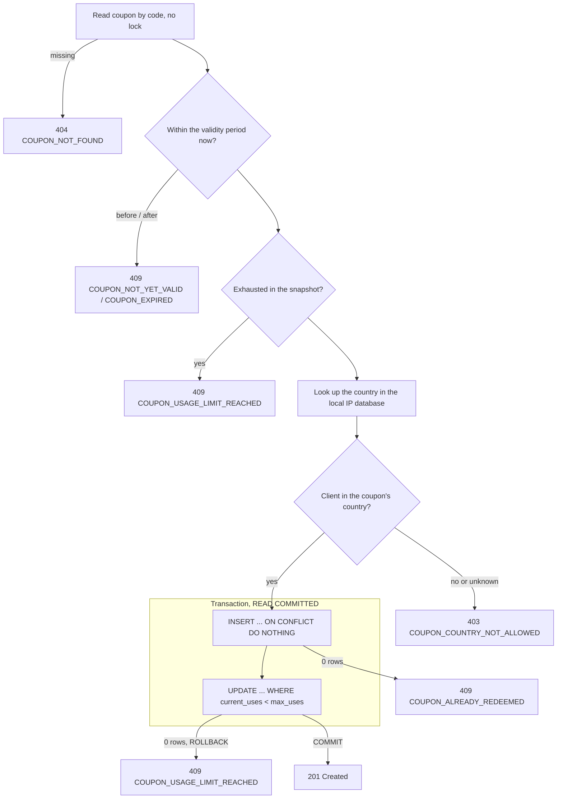
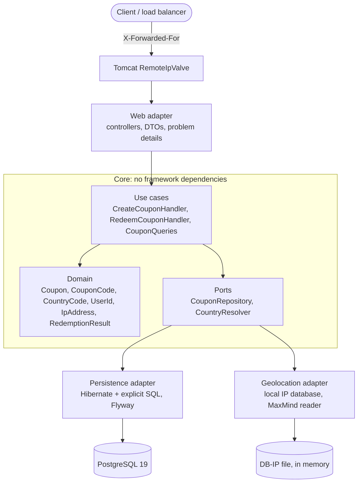

# Coupon Service

REST service for creating discount coupons and registering their use. A coupon has a
case-insensitive unique code, a usage limit and a country; it can be redeemed only by clients
from that country (by IP), first come first served, and at most once per user.

**Highlights**

- **The usage limit holds under any concurrency, on any number of instances.** It is enforced by
  a single conditional `UPDATE` in PostgreSQL, not by locks in the JVM, and proven by a test that
  races 500 threads for 50 uses on a real database.
- **Every error is a stable, documented contract:** RFC 9457 problem details with an `errorCode`,
  and the mapping of business outcomes to HTTP is an exhaustive `switch` the compiler checks.
- **Geolocation that scales:** countries come from a local IP database in memory, so there is no
  rate-limited API call per request, and `X-Forwarded-For` is trusted only from known proxies.
- **Hexagonal architecture enforced by ArchUnit**, 132 tests from domain to end to end on real
  PostgreSQL (Testcontainers), a 90% coverage gate on the business code, CI on GitHub Actions.
- **Ready to operate:** health probes, Prometheus metrics, structured JSON logs, graceful shutdown,
  a non-root container image, fail-fast connection pool, no personal data in logs.

**Stack:** Java 25 (LTS), Spring Boot 4.2, PostgreSQL 19, Hibernate 7, Flyway, Gradle 9,
DB-IP IP-to-country database read with MaxMind's reader, JUnit 6, Testcontainers 2, ArchUnit.

## Requirements and how they are met

| Requirement | Implementation | Proven by |
| --- | --- | --- |
| Create a coupon: unique code, creation date, max uses, current uses, country | `POST /api/v1/coupons`; Flyway schema with the invariants repeated as constraints | `CouponControllerTest`, `JpaCouponRepositoryAdapterTest`, `SchemaConstraintsTest` |
| Register a use of a coupon by a user | `POST /api/v1/coupons/{code}/redemptions` with `{"userId"}` | `RedeemCouponHandlerTest`, `CouponApiEndToEndTest` |
| Code unique regardless of case (`WIOSNA` = `wiosna`) | Normalized once in `CouponCode` (`Locale.ROOT`), plain `UNIQUE` in the database | `CouponCodeTest` (also under a Turkish locale), a race of five spellings with one winner |
| Limited number of uses, first come first served | `UPDATE ... WHERE current_uses < max_uses` in one short transaction | `CouponRedemptionConcurrencyTest`: 500 threads, 50 uses, exactly 50 winners |
| Only clients from the coupon's country, by IP, free service | DB-IP Lite (free, CC BY 4.0) looked up in memory; client IP from trusted proxies only | `IpDatabaseCountryResolverTest`, end to end with IPv4 and IPv6 clients |
| Clear answers for: limit reached, unknown code, wrong country, already used | `409 COUPON_USAGE_LIMIT_REACHED`, `404 COUPON_NOT_FOUND`, `403 COUPON_COUNTRY_NOT_ALLOWED`, `409 COUPON_ALREADY_REDEEMED` | `RedemptionControllerTest`, `CouponApiEndToEndTest` |
| (Optional) One use per user, request carries the user id and the code | Unique `(coupon_id, user_id)` and `INSERT ... ON CONFLICT DO NOTHING` | 50 parallel attempts by one user, exactly one wins |
| Scalable, data in a database | Stateless instances, the database is the only shared state; no external call per request | Concurrency tests on real PostgreSQL, `scripts/RedeemStorm.java` over HTTP |
| Java or Kotlin, Maven or Gradle | Java 25, Gradle 9 with a version catalog | `./gradlew build`, CI |

Beyond the task: an optional validity period per coupon, and `GET` on a redemption so a client
that lost the answer to its `POST` can check the outcome instead of retrying blindly.

## Quick start

Requirements: Docker (for PostgreSQL and the tests) and any JDK 17+ to start Gradle; Gradle
provisions Java 25 itself.

```bash
# Build and run every test (unit, web, Testcontainers, end to end, architecture, coverage gate)
./gradlew build

# Run the service on :8080; PostgreSQL starts from compose.yaml, and the first run downloads
# the IP-to-country database (8 MB) into build/geo
./gradlew bootRun

# Or everything in containers
docker compose --profile app up --build
```

```bash
# Create a coupon (codes are case-insensitive and stored upper case)
curl -i -X POST localhost:8080/api/v1/coupons -H 'Content-Type: application/json' \
     -d '{"code": "wiosna", "maxUses": 2, "country": "PL"}'

# Redeem it as a client from Poland. Locally the service trusts X-Forwarded-For from localhost,
# so the header stands in for the client IP: 212.77.98.9 is in Poland, 46.4.0.1 in Germany.
curl -i -X POST localhost:8080/api/v1/coupons/WIOSNA/redemptions -H 'Content-Type: application/json' \
     -H 'X-Forwarded-For: 212.77.98.9' -d '{"userId": "user-1"}'
```

Every scenario as a ready-made request: [`requests.http`](requests.http). Swagger UI:
<http://localhost:8080/swagger-ui.html>.

## API

| Method and path | Body | Success |
| --- | --- | --- |
| `POST /api/v1/coupons` | `{"code", "maxUses", "country", "validFrom"?, "validUntil"?}` | `201` with `Location` and the coupon |
| `GET /api/v1/coupons/{code}` | | `200` with the coupon |
| `POST /api/v1/coupons/{code}/redemptions` | `{"userId"}` | `201` with `Location` and the redemption |
| `GET /api/v1/coupons/{code}/redemptions/{userId}` | | `200` with the redemption |

`validFrom` and `validUntil` are optional ISO 8601 instants. The period is half-open: from
`validFrom` (inclusive) until `validUntil` (exclusive), so `"validUntil": "2026-12-01T00:00:00Z"`
means "through the whole of November". A missing side is open.

Errors are [RFC 9457](https://www.rfc-editor.org/rfc/rfc9457) problem details with an `errorCode`
member. Clients branch on `errorCode`, since two problems can share a status.

| Situation | Status | `errorCode` |
| --- | --- | --- |
| Missing field, bad code or country format, `maxUses` < 1, `validUntil` not after `validFrom` or not in the future | 400 | `VALIDATION_FAILED` |
| Body is not valid JSON | 400 | `MALFORMED_REQUEST` |
| Code already exists, in any letter case | 409 | `COUPON_CODE_ALREADY_EXISTS` |
| Coupon does not exist | 404 | `COUPON_NOT_FOUND` |
| Coupon exists, but this user has not redeemed it (`GET` on a redemption) | 404 | `REDEMPTION_NOT_FOUND` |
| Client country differs from the coupon's, or cannot be determined | 403 | `COUPON_COUNTRY_NOT_ALLOWED` |
| Before `validFrom` | 409 | `COUPON_NOT_YET_VALID` |
| At or after `validUntil` | 409 | `COUPON_EXPIRED` |
| Usage limit reached | 409 | `COUPON_USAGE_LIMIT_REACHED` |
| This user already redeemed this coupon | 409 | `COUPON_ALREADY_REDEEMED` |
| Database down, or every pooled connection busy for 2 s (overload) | 503 + `Retry-After` | `SERVICE_UNAVAILABLE` |
| Unknown path, wrong method or media type | 404, 405, 415... | `UNSUPPORTED_REQUEST` |
| Anything unforeseen (logged with its stack trace, never returned) | 500 | `INTERNAL_ERROR` |

"Already redeemed" takes precedence: a user who took the last use and retries is told that they
already used the coupon, not that it ran out, because that is what actually stops them.

## The core: concurrent redemption

The usage limit and "one use per user" are enforced by PostgreSQL. Two statements run in one
short `READ COMMITTED` transaction:

```sql
-- 1. Record the redemption; 0 rows means this user already redeemed the coupon.
INSERT INTO coupon_redemptions (coupon_id, user_id, redeemed_at)
SELECT c.id, :userId, :redeemedAt FROM coupons c WHERE c.code = :code
ON CONFLICT (coupon_id, user_id) DO NOTHING;

-- 2. Consume one use only if one is left; 0 rows means the limit is reached -> ROLLBACK.
UPDATE coupons SET current_uses = current_uses + 1
WHERE code = :code AND current_uses < max_uses;
```



Why this is correct:

- **No over-redemption.** A second `UPDATE` of the same row waits for the row lock; after the
  first transaction commits, PostgreSQL re-evaluates `current_uses < max_uses` against the newest
  row version. The counter cannot pass the limit and no increment is lost.
- **One use per user.** A concurrent `INSERT` of the same (coupon, user) pair waits for the other
  transaction: after its commit it conflicts (0 rows), after its rollback it proceeds.
- **All or nothing.** If the `UPDATE` finds no use left, the transaction rolls back and the
  redemption row disappears with it.
- **Short locks, no deadlocks.** The `INSERT` goes first, so the hot coupon row is locked only from
  the `UPDATE` to `COMMIT`. The foreign key check takes `FOR KEY SHARE` on the coupon row and the
  counter update takes `FOR NO KEY UPDATE`; those modes do not conflict, and every transaction
  locks in the same order.
- **Nothing slow inside the transaction.** Every check runs before it, so locks are held only for
  the two statements.
- **Any number of instances.** The database is the only shared state.
- **Safe fast path.** The exhausted check reads without locks. The counter only grows, so a snapshot
  that says "exhausted" is never wrong.
- **One clock reading.** The instant checked against the validity period is the one stored as
  `redeemed_at`, so a recorded redemption never falls outside the coupon's period.

The tests raise confidence; the guarantee comes from the SQL above.

## Architecture

Hexagonal, in one module. The domain and the use cases have no framework dependencies;
Spring, Hibernate and HTTP live in adapters behind ports. ArchUnit enforces it.



```
pl.hadacz.coupons
├── coupon
│   ├── domain           value objects, Coupon, ValidityPeriod, RedemptionResult (sealed)
│   ├── application      use cases; port/ holds CouponRepository and CountryResolver
│   └── adapter
│       ├── web          controllers, request/response records, problem details, metrics
│       ├── persistence  JPA entity, Spring Data repository, port implementation
│       └── geolocation  CountryResolver over the local IP database
└── config               wiring of the framework-free use cases, OpenAPI
```

Commands (create, redeem) go through the domain and a transaction; the query side
(`CouponQueries`) returns a view and could read from a replica. With two tables, a separate read
model would be overhead.

## Geolocation and the client IP

- **Client IP.** `server.forward-headers-strategy=native` enables Tomcat's `RemoteIpValve`:
  `X-Forwarded-For` is used only when the request comes from a trusted proxy
  (`server.tomcat.remoteip.internal-proxies`). In production that is the load balancer's address
  range. Reading the header directly would let any client claim a Polish IP.
- **Local database.** [DB-IP's IP to Country Lite](https://db-ip.com/db/download/ip-to-country-lite)
  (free, CC BY 4.0, no API key, updated monthly) in the standard MaxMind DB format, read into memory
  at startup with MaxMind's own reader. A lookup needs no network call: no rate limit, no latency,
  no provider outage. A missing file stops the startup rather than running without geolocation.
- **Never guessed.** Private, loopback and similar addresses have no country, whatever a database says.
- **Fail closed.** If the country cannot be determined, the coupon is not redeemed (403). Failing
  open instead would be a business decision, not a technical default.
- **GDPR.** An IP address is personal data. The service does not store it, log it or send it anywhere.

## Testing

| Level | Tools | What it checks |
| --- | --- | --- |
| Domain | JUnit 6, AssertJ | Code normalization (also under a Turkish default locale), ISO countries, IP classification, coupon invariants, validity period bounds |
| Use cases | In-memory fakes, fixed `Clock` | Every `RedemptionResult`, order of checks, no country lookup for missing, expired or exhausted coupons |
| Web | `@WebMvcTest`, `MockMvcTester` | Status codes, `Location`, problem details, validation, database outage as 503 |
| Persistence | Testcontainers PostgreSQL 19 | Schema constraints, duplicate codes, the atomic redemption |
| Concurrency | Virtual threads, start gate | Limit never exceeded, one use per user, racing creations of `WIOSNA`/`wiosna` |
| Geolocation | MaxMind's test database | IPv4 and IPv6 lookups, addresses without data, private addresses, a missing file |
| End to end | `RestTestClient` on a random port | Full flow through Tomcat, including `X-Forwarded-For` with IPv4 and IPv6 clients |
| Architecture | ArchUnit | Core free of frameworks, adapters independent |

The build fails below 90% line coverage of the domain and application packages.
`java scripts/RedeemStorm.java WIOSNA 1000` fires concurrent redemptions at a running service and
prints the outcome histogram: with a limit of N, exactly N succeed.

## Design decisions

**1. Enforce the limit atomically in PostgreSQL.** A conditional `UPDATE` plus
`INSERT ... ON CONFLICT` in one transaction. Rejected: JVM locks (work within one instance only);
load-modify-save with JPA (classic lost update); optimistic locking with `@Version` (a popular coupon
turns into a storm of conflicts and retries); `SELECT ... FOR UPDATE` (holds the lock through the
read, the Java logic and the write); `SERIALIZABLE` (needs retry handling for no benefit, since one
statement is already atomic); a Redis counter (a second source of truth and more infrastructure).

**2. Normalize codes in the domain, enforce uniqueness in the database.** `CouponCode` upper-cases
with `Locale.ROOT` and the column has a plain `UNIQUE` constraint, so a race between `WIOSNA` and
`wiosna` has exactly one winner. Rejected: `citext` or a unique index on `lower(code)`; they work
but hide the business rule in the database.

**3. Hibernate for CRUD, explicit SQL for the redemption.** Spring Data JPA keeps the create and read
code short. The redemption needs exact SQL semantics, so it is a JPQL bulk update and a native
insert, both `Propagation.MANDATORY` so they cannot run outside the redemption transaction. The bulk
update bypasses the persistence context, which is safe because that transaction never loads the
entity. Also deliberate: `open-in-view=false`, `ddl-auto=validate` against Flyway, UUIDv7 ids
generated by Hibernate (so `save` is a persist, not a merge), and `saveAndFlush` on create so a
duplicate code surfaces inside the adapter.

**4. Business outcomes as values.** `RedemptionResult` is a sealed interface of records, mapped to
HTTP and to metric tags with exhaustive `switch`es: a new outcome does not compile until it has both.
Exceptions are reserved for invalid input and technical failures.

**5. A local IP-to-country database.** A free web API called per redemption does not scale: they
are rate limited (country.is allows 10 requests/s), every instance calls from the same egress IP,
an outage would stop all redemptions, and client IPs would go to a third party. DB-IP Lite is free,
needs no key and ships in the standard MaxMind DB format, so MaxMind's reader does the lookup in
memory. Rejected: MaxMind GeoLite2 (needs an account and a license key, so the project would not
build out of the box), a table in PostgreSQL (an extra query on the hottest path, against the
database that is already the bottleneck).

**6. Client IP only through `RemoteIpValve` with trusted proxies.** Rejected: Spring's
`ForwardedHeaderFilter` (trusts every header) and reading `X-Forwarded-For` by hand.

**7. Virtual threads with a deliberately sized connection pool.** Blocking code stays simple; the
pool (20 connections, 2 s timeout) is the real concurrency limit for the database and fails fast
under overload, answered as 503. Rejected: WebFlux with R2DBC, more complex for no gain here.

## Operations

| Setting | Default | Purpose |
| --- | --- | --- |
| `DB_URL`, `DB_USERNAME`, `DB_PASSWORD` | local compose database | PostgreSQL connection |
| `DB_POOL_SIZE` | `20` | Connection pool size, the concurrency limit for the database |
| `GEO_DATABASE` | `file:build/geo/dbip-country-lite.mmdb` | IP-to-country database; the image sets its own path |
| `SPRING_PROFILES_ACTIVE=prod` | off | JSON logs in Elastic Common Schema |
| `server.tomcat.remoteip.internal-proxies` | loopback and private networks | Proxies whose `X-Forwarded-For` is trusted |

- **Health:** `/actuator/health/liveness` and `/actuator/health/readiness` (readiness checks the
  database, so an instance without it leaves the load balancer).
- **Metrics:** `/actuator/prometheus`, including `coupons_redemptions_total{outcome=...}` for every
  outcome, HTTP latencies and connection pool usage.
- **Logs:** no IP addresses; unexpected errors with their stack trace, database outages as warnings.
- **Image:** multi-stage, JRE only, non-root user, the IP database baked in; graceful shutdown.

## Scaling, limits and next steps

- **Hot row.** All redemptions of one coupon serialize on one row; different coupons do not block
  each other. If a single campaign outgrows that: sharded counters (N rows per coupon), a pool of
  pre-created tokens claimed with `FOR UPDATE SKIP LOCKED`, or a Redis counter reconciled with the
  database.
- **Geolocation data** is as fresh as the image: DB-IP publishes monthly, so the image is rebuilt
  at least monthly. Behind a CDN, a country header such as `CF-IPCountry` would be one more adapter
  behind `CountryResolver`.
- **Security.** Authentication was out of scope. In production `userId` comes from the access
  token (`sub`), not the body; creating coupons requires a role; rate limiting sits at the gateway.
- **Assumptions.** Code, country, limit and validity period never change and coupons are not
  deleted, which is what makes the lock-free read safe. Uses are never given back.
- **Next steps.** `CouponRedeemed` events for CRM and analytics through a transactional outbox (the
  event row written in the redemption transaction, relayed to Kafka); coupon deactivation; releasing
  a use when an order is cancelled (a compensating step, which would end the "counter only grows"
  assumption); a JVM AOT cache in the image for faster scale-out.

## Data attribution

IP geolocation by [DB-IP](https://db-ip.com), licensed under
[CC BY 4.0](https://creativecommons.org/licenses/by/4.0/). The file is downloaded at build time and
is not part of this repository. The test database in `src/test/resources/geo` is MaxMind's, under
the Apache License 2.0 or MIT.
