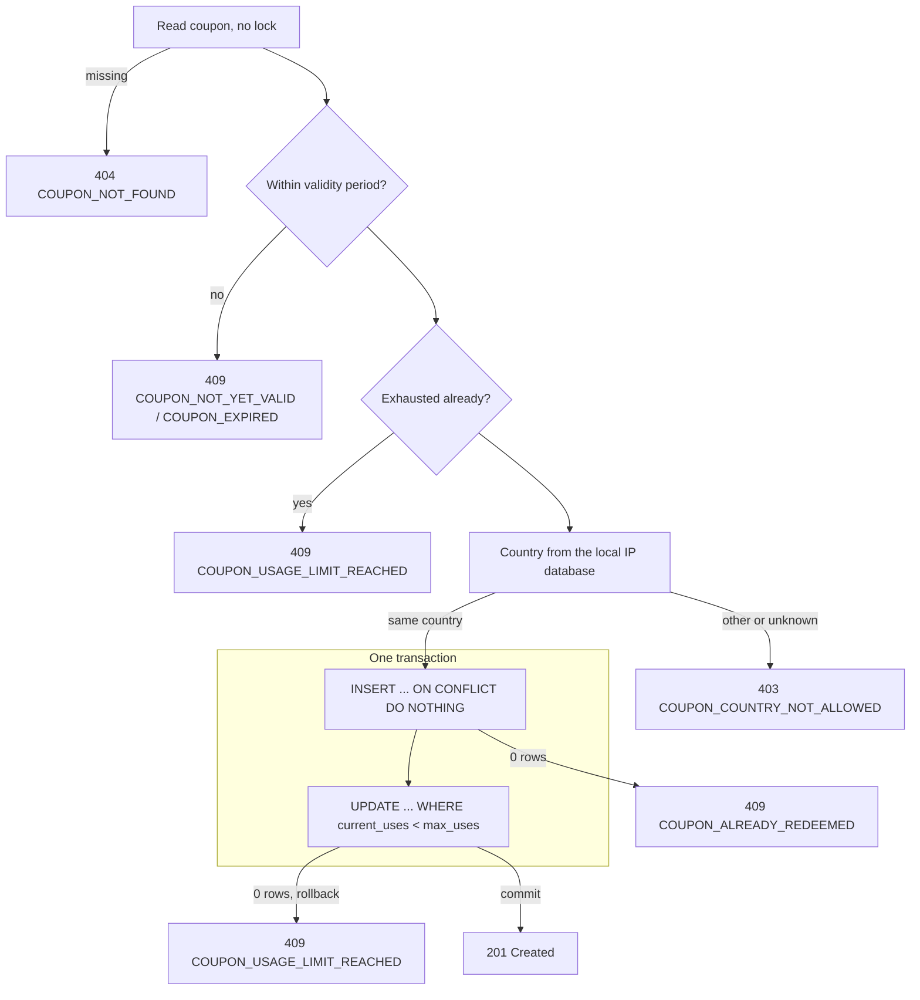
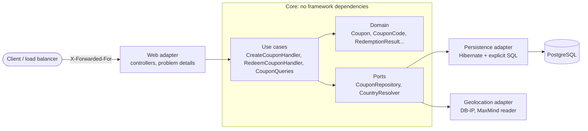

# Coupon Service

A REST service for creating discount coupons and registering their use. Each coupon has a
case-insensitive unique code, a usage limit and a country: it can be used only by clients from
that country (by IP), first come first served, at most once per user, and the limit holds under
any number of concurrent requests and service instances.

> **Reviewer's path (5 minutes):** the [requirements table](#requirements) → [how the limit holds
> under concurrency](#concurrency) → `RedeemCouponHandler` and `JpaCouponRepositoryAdapter` →
> `CouponRedemptionConcurrencyTest` (500 threads, 50 uses, exactly 50 winners).

**Contents:** [At a glance](#at-a-glance) · [Requirements](#requirements) · [Run it](#run-it) ·
[API](#api) · [Concurrency](#concurrency) · [Architecture and patterns](#architecture) ·
[Decisions](#decisions) · [Production readiness](#production-readiness) · [Testing](#testing) ·
[Limits and next steps](#limits)

<a id="at-a-glance"></a>
## At a glance

| | |
| --- | --- |
| **Stack** | Java 25 (LTS), Spring Boot 4.2, PostgreSQL 19, Hibernate 7, Flyway, Gradle 9 |
| **Architecture** | Hexagonal (ports and adapters): framework-free domain and use cases, enforced by ArchUnit |
| **Concurrency** | The limit is one conditional `UPDATE` in PostgreSQL, so it holds across threads and instances |
| **Geolocation** | Free DB-IP database, looked up in memory: no rate-limited API call per request |
| **API contract** | RFC 9457 problem details with a stable `errorCode` for every error |
| **Quality** | 132 tests from domain to end to end on real PostgreSQL, 90% coverage gate, CI |
| **Operations** | Health probes, Prometheus metrics, JSON logs, non-root container image |

<a id="requirements"></a>
## Requirements and how they are met

| Requirement | Implementation | Proven by |
| --- | --- | --- |
| Create a coupon: unique code, creation date, max uses, current uses, country | `POST /api/v1/coupons`; Flyway schema repeats the rules as constraints | `CouponControllerTest`, `JpaCouponRepositoryAdapterTest`, `SchemaConstraintsTest` |
| Register a use of a coupon by a user | `POST /api/v1/coupons/{code}/redemptions` with `{"userId"}` | `RedeemCouponHandlerTest`, `CouponApiEndToEndTest` |
| Code unique regardless of case (`WIOSNA` = `wiosna`) | Normalized once in `CouponCode` (`Locale.ROOT`), plain `UNIQUE` in the database | `CouponCodeTest` (also under a Turkish locale); five spellings created at once, one wins |
| Limited uses, first come first served | `UPDATE ... WHERE current_uses < max_uses` in one short transaction | `CouponRedemptionConcurrencyTest`: 500 threads, 50 uses, exactly 50 winners |
| Only clients from the coupon's country, by IP, free service | DB-IP Lite (free, CC BY 4.0) in memory; client IP only from trusted proxies | `IpDatabaseCountryResolverTest`; end to end with IPv4 and IPv6 clients |
| Clear answer when: limit reached, unknown code, wrong country, already used | `409 COUPON_USAGE_LIMIT_REACHED`, `404 COUPON_NOT_FOUND`, `403 COUPON_COUNTRY_NOT_ALLOWED`, `409 COUPON_ALREADY_REDEEMED` | `RedemptionControllerTest`, `CouponApiEndToEndTest` |
| (Optional) One use per user; request carries user id and code | `UNIQUE (coupon_id, user_id)` with `INSERT ... ON CONFLICT DO NOTHING` | 50 parallel attempts by one user: exactly one wins |
| Scalable; data in a database | Stateless instances; the database is the only shared state | Concurrency tests on real PostgreSQL; `scripts/RedeemStorm.java` over HTTP |
| Java or Kotlin; Maven or Gradle | Java 25, Gradle 9 with a version catalog | `./gradlew build`, GitHub Actions |

Beyond the task: an optional validity period per coupon, and `GET` on a redemption, so a client
that lost the answer to its `POST` can check the outcome instead of retrying blindly.

<a id="run-it"></a>
## Run it

You need Docker (for PostgreSQL and the tests) and any JDK 17+ to start Gradle, which then
provisions Java 25 itself.

```bash
./gradlew build                          # all tests, architecture rules and the coverage gate
./gradlew bootRun                        # the service on :8080; PostgreSQL starts from compose.yaml
docker compose --profile app up --build  # or everything in containers
```

The first `bootRun` downloads the IP-to-country database (8 MB) into `build/geo`.

```bash
# Create a coupon (codes are case-insensitive and stored upper case)
curl -i -X POST localhost:8080/api/v1/coupons -H 'Content-Type: application/json' \
     -d '{"code": "wiosna", "maxUses": 2, "country": "PL"}'

# Use it as a client from Poland. Locally the service trusts X-Forwarded-For from localhost,
# so the header stands in for the client IP: 212.77.98.9 is in Poland, 46.4.0.1 in Germany.
curl -i -X POST localhost:8080/api/v1/coupons/WIOSNA/redemptions -H 'Content-Type: application/json' \
     -H 'X-Forwarded-For: 212.77.98.9' -d '{"userId": "user-1"}'
```

Every scenario as a ready-made request: [`requests.http`](requests.http).
Swagger UI: <http://localhost:8080/swagger-ui.html>.

<a id="api"></a>
## API

| Method and path | Body | Success |
| --- | --- | --- |
| `POST /api/v1/coupons` | `{"code", "maxUses", "country", "validFrom"?, "validUntil"?}` | `201` with `Location` and the coupon |
| `GET /api/v1/coupons/{code}` | | `200` with the coupon |
| `POST /api/v1/coupons/{code}/redemptions` | `{"userId"}` | `201` with `Location` and the redemption |
| `GET /api/v1/coupons/{code}/redemptions/{userId}` | | `200` with the redemption |

```json
{"code": "WIOSNA", "country": "PL", "maxUses": 2, "currentUses": 1,
 "validFrom": null, "validUntil": null, "createdAt": "2026-11-24T10:00:00.123456Z"}
```

`validFrom` and `validUntil` are optional ISO 8601 instants, half-open: valid from `validFrom`
(inclusive) until `validUntil` (exclusive). Errors are [RFC 9457](https://www.rfc-editor.org/rfc/rfc9457)
problem details with an `errorCode`; clients branch on `errorCode`, since two problems can share a status.

| Situation | Status | `errorCode` |
| --- | --- | --- |
| Invalid input (missing field, bad code or country, `maxUses` < 1, bad validity period) | 400 | `VALIDATION_FAILED` |
| Body is not valid JSON | 400 | `MALFORMED_REQUEST` |
| Code already exists, in any letter case | 409 | `COUPON_CODE_ALREADY_EXISTS` |
| Coupon does not exist | 404 | `COUPON_NOT_FOUND` |
| Client's country differs from the coupon's, or cannot be determined | 403 | `COUPON_COUNTRY_NOT_ALLOWED` |
| Usage limit reached | 409 | `COUPON_USAGE_LIMIT_REACHED` |
| This user already used this coupon | 409 | `COUPON_ALREADY_REDEEMED` |
| Before `validFrom` / at or after `validUntil` | 409 | `COUPON_NOT_YET_VALID` / `COUPON_EXPIRED` |
| `GET` on a redemption the user has not made | 404 | `REDEMPTION_NOT_FOUND` |
| Database down or overloaded (pool busy for 2 s) | 503 + `Retry-After` | `SERVICE_UNAVAILABLE` |
| Unknown path, wrong method or media type | 404, 405, 415 | `UNSUPPORTED_REQUEST` |
| Anything unforeseen (logged with the stack trace, never returned) | 500 | `INTERNAL_ERROR` |

"Already used" wins over other refusals for that user: someone who took the last use and retries
is told they already used the coupon, because that is what actually stops them.

<a id="concurrency"></a>
## Concurrency: how the limit holds

The limit and "one use per user" are enforced by PostgreSQL, not by locks in the JVM. Two
statements run in one short `READ COMMITTED` transaction:

```sql
-- 1. Record the use; 0 rows means this user already used the coupon.
INSERT INTO coupon_redemptions (coupon_id, user_id, redeemed_at)
SELECT c.id, :userId, :redeemedAt FROM coupons c WHERE c.code = :code
ON CONFLICT (coupon_id, user_id) DO NOTHING;

-- 2. Consume one use only if one is left; 0 rows means the limit is reached -> ROLLBACK.
UPDATE coupons SET current_uses = current_uses + 1
WHERE code = :code AND current_uses < max_uses;
```

| Guarantee | Mechanism |
| --- | --- |
| Never more uses than the limit | A concurrent `UPDATE` of the same row waits for the row lock, then PostgreSQL re-checks `current_uses < max_uses` on the newest version: no lost update, no overshoot |
| One use per user | `UNIQUE (coupon_id, user_id)`: a parallel insert of the same pair waits and then conflicts |
| All or nothing | Both statements in one transaction; when no use is left, the rollback removes the recorded use |
| Case-insensitive uniqueness under races | Codes are normalized before the `UNIQUE` check, so `WIOSNA` and `wiosna` created at once have one winner |
| Short locks, no deadlocks | The insert goes first, so the hot row is locked only from the `UPDATE` to `COMMIT`; lock modes do not conflict and the order is always the same |
| Any number of instances | No shared state outside the database; nothing slow (no I/O) inside the transaction |
| Cheap refusals | Expired and exhausted coupons are refused from a lock-free read, safe because the counter only grows |



<a id="architecture"></a>
## Architecture and patterns



```
pl.hadacz.coupons
├── coupon
│   ├── domain           value objects, Coupon, ValidityPeriod, RedemptionResult (sealed)
│   ├── application      use cases; port/ holds CouponRepository and CountryResolver
│   └── adapter
│       ├── web          controllers, request/response records, problem details, metrics
│       ├── persistence  JPA entity, Spring Data repository, port implementation
│       └── geolocation  CountryResolver over the local IP database
└── config               wiring of the framework-free use cases, OpenAPI
```

| Pattern | Where | Why |
| --- | --- | --- |
| Ports and adapters | `domain`, `application` vs `adapter` | Business rules tested in milliseconds without a database; a geolocation source can be swapped without touching them. ArchUnit fails the build on a wrong dependency |
| Value objects | `CouponCode`, `CountryCode`, `UserId`, `IpAddress`, `ValidityPeriod` | Each rule lives in one place and an invalid value cannot be constructed |
| Sealed result type | `RedemptionResult`, `CreateCouponResult` | Business outcomes are values, mapped to HTTP and metrics by exhaustive `switch`es: a new outcome does not compile until it is handled |
| Repository | `CouponRepository` port, JPA adapter | The use cases speak domain terms; SQL stays in the adapter |
| Command/query separation | Handlers vs `CouponQueries` | The read side could move to a replica without touching the write path |
| Atomic conditional update | `CouponJpaRepository` | Correctness across instances without locks held in Java |
| Problem details | `Problems`, `ApiExceptionHandler` | One error format for business refusals, invalid input and failures |
| Injected `Clock` | `CouponConfiguration` | Time-dependent rules are tested deterministically |

<a id="decisions"></a>
## Decisions

| Decision | Why | Rejected |
| --- | --- | --- |
| Enforce the limit with a conditional `UPDATE` in PostgreSQL | Atomic in one statement, on any number of instances, no retries | JVM locks (one instance only), load-modify-save (lost updates), `@Version` (retry storms on a popular coupon), `SELECT ... FOR UPDATE` (longer locks), `SERIALIZABLE` (retries for no gain), Redis counter (second source of truth) |
| Normalize codes in the domain, `UNIQUE` in the database | The rule is visible in code; the database decides races | `citext` or a unique index on `lower(code)`: they work but hide the rule |
| Hibernate for create and read, explicit SQL for redemption | Short CRUD code; exact SQL semantics where they matter. Redemption queries are `Propagation.MANDATORY`, so they cannot run outside its transaction | Redemption through entities (lost updates) |
| Business outcomes as values, exceptions only for failures | Exhaustive handling checked by the compiler | Exceptions for "limit reached" and similar expected outcomes |
| Local IP database (DB-IP Lite) | Free, no key, no network call per request: no rate limit, no outage, IPs stay inside | Free web APIs (rate limits such as 10 requests/s from one egress IP), MaxMind GeoLite2 (needs an account and license key), a table in PostgreSQL (load on the bottleneck) |
| Client IP only via Tomcat's `RemoteIpValve` with trusted proxies | A client cannot claim another country with a forged header | Spring's `ForwardedHeaderFilter` (trusts every header), reading the header by hand |
| Virtual threads with a deliberately sized pool | Simple blocking code; the pool (20, 2 s timeout) bounds database load and fails fast as 503 | WebFlux and R2DBC (more complexity for no gain here) |

<a id="production-readiness"></a>
## Production readiness

| Concern | How it is handled |
| --- | --- |
| Correctness under load | Atomic SQL and database constraints; proven with 500 concurrent threads on real PostgreSQL |
| Horizontal scaling | Stateless instances, no per-request calls to external services |
| Schema and data integrity | Flyway migrations; `ddl-auto=validate`; business rules repeated as `CHECK` and `UNIQUE` constraints |
| Failure handling | Database outage or overload answers 503 with `Retry-After` and recovers on its own; readiness takes the instance out of the load balancer; graceful shutdown |
| Observability | `/actuator/prometheus` with `coupons_redemptions_total{outcome}`, HTTP latencies and pool usage; liveness and readiness probes; JSON logs (ECS) in the `prod` profile |
| Security and privacy | Validated input; forwarded IPs trusted only from proxies; client IPs never stored, logged or sent anywhere; non-root container |
| Delivery | Multi-stage Docker image with the IP database inside; compose for local runs; GitHub Actions builds and tests every push |

| Setting | Default | Purpose |
| --- | --- | --- |
| `DB_URL`, `DB_USERNAME`, `DB_PASSWORD` | local compose database | PostgreSQL connection |
| `DB_POOL_SIZE` | `20` | Connection pool, the concurrency limit for the database |
| `GEO_DATABASE` | `file:build/geo/dbip-country-lite.mmdb` | IP-to-country database (the image sets its own path) |
| `SPRING_PROFILES_ACTIVE` | none | `prod` switches to JSON logs |
| `server.tomcat.remoteip.internal-proxies` | loopback and private networks | Proxies whose `X-Forwarded-For` is trusted; in production, the load balancer |

<a id="testing"></a>
## Testing

| Level | Tools | What it checks |
| --- | --- | --- |
| Domain | JUnit 6, AssertJ | Code normalization (also under a Turkish locale), ISO countries, IP classification, coupon invariants, validity bounds |
| Use cases | In-memory fakes, fixed `Clock` | Every outcome and the order of checks |
| Web | `@WebMvcTest`, `MockMvcTester` | Status codes, `Location`, problem details, validation, 503 on a database outage |
| Persistence | Testcontainers PostgreSQL 19 | Schema constraints, duplicate codes, the atomic redemption |
| Concurrency | Virtual threads, start gate | Limit never exceeded, one use per user, racing creations of `WIOSNA`/`wiosna` |
| Geolocation | MaxMind's test database | IPv4 and IPv6 lookups, unknown and private addresses, a missing file |
| End to end | `RestTestClient` on a random port | Full flow through Tomcat, including `X-Forwarded-For` from IPv4 and IPv6 clients |
| Architecture | ArchUnit | Core free of frameworks, adapters independent of each other |

The build fails below 90% line coverage of the domain and use cases. Against a running service,
`java scripts/RedeemStorm.java WIOSNA 1000` fires concurrent requests and prints the outcomes:
with a limit of N, exactly N succeed.

<a id="limits"></a>
## Limits and next steps

- **Hot coupon.** Uses of one coupon serialize on one row; different coupons never block each
  other. For a single campaign beyond that: sharded counters, a pool of pre-created tokens claimed
  with `FOR UPDATE SKIP LOCKED`, or a Redis counter reconciled with the database.
- **Authentication** was out of scope. In production `userId` comes from the access token, creating
  coupons requires a role, and rate limiting sits at the gateway.
- **Geolocation data** is as fresh as the image; DB-IP publishes monthly, so the image is rebuilt
  monthly. A CDN country header (e.g. `CF-IPCountry`) would be one more adapter.
- **Assumptions.** Code, country, limit and validity period never change and coupons are not
  deleted, which makes the lock-free read safe. Uses are never given back.
- **Next steps.** `CouponRedeemed` events for CRM through a transactional outbox (written in the
  redemption transaction, relayed to Kafka); coupon deactivation; returning a use when an order is
  cancelled; a JVM AOT cache for faster scale-out.

## Data attribution

IP geolocation by [DB-IP](https://db-ip.com), licensed under
[CC BY 4.0](https://creativecommons.org/licenses/by/4.0/); downloaded at build time, not part of
this repository. The test database in `src/test/resources/geo` is MaxMind's (Apache 2.0 or MIT).
